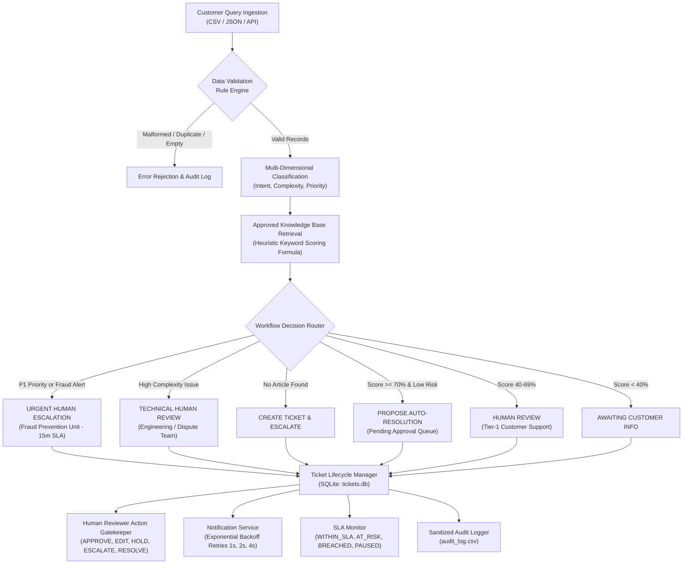

# Intelligent Banking Dispute & Fraud Triage System with Multi-Tier Escalation

**Institution:** Vivekanand Education Society's Institute of Technology  
**Domain:** FinTech & Digital Banking Services  
**Course / Laboratory:** Case Study – Intelligent Customer Support System with Escalation  

---

## 🎯 Aim
To design, implement, test, and evaluate an **Intelligent Customer Support and Dispute Resolution System** in the FinTech banking domain that:
- Ingests and validates customer banking queries, filtering malformed records and duplicate query IDs.
- Classifies incoming queries by **Intent**, **Complexity**, and **Priority** (`P1`, `P2`, `P3`, `P4`).
- Retrieves verified bank support articles from an approved knowledge base and computes heuristic match scores ($C = 100 \times \frac{\text{matched}}{\text{total}}$).
- Routes queries safely: critical security incidents and fraud bypass automated answers and escalate immediately to fraud specialists.
- Manages full ticket lifecycles in **SQLite** (`OPEN` $\rightarrow$ `TRIAGED` $\rightarrow$ `ASSIGNED/IN_PROGRESS` $\rightarrow$ `RESOLVED` $\rightarrow$ `CLOSED` or `REOPENED`).
- Dispatches event notifications with **exponential backoff retries** and **idempotency key protection**.
- Monitors and enforces strict **Service-Level Agreements (SLAs)** (`WITHIN_SLA`, `AT_RISK`, `BREACHED`, `PAUSED`).
- Records an immutable, sanitized regulatory audit trail in `audit_log.csv`.

---

## 🏗️ System Architecture & Workflow



---

## 📁 Project Structure

```text
IntelligentCustomerSupport/
├── app.py                  # Main orchestration script and pipeline runner
├── customer_queries.csv    # Synthetic banking queries (normal, edge cases, duplicates)
├── knowledge_base.json     # Curated bank policy and FAQ articles
├── config.json             # SLA parameters, retry settings, and authorized reviewer list
├── classifier.py           # Multi-dimensional classification engine
├── resolver.py             # Knowledge retrieval and heuristic scoring
├── ticket_manager.py       # Ticket schema, state machine, and SQLite persistence
├── workflow_router.py      # Threshold decision router & safety guardrails
├── notifications.py        # Notification generator with exponential backoff & idempotency
├── sla_monitor.py          # SLA deadline calculation, at-risk alerts, and breach detector
├── audit_logger.py         # Regulatory compliance event logger with data sanitization
├── hitl_dashboard.py       # Human-in-the-Loop Web & CLI Supervisor Portal (Streamlit / Terminal)
├── mcp_server.py           # Model Context Protocol (MCP) server for external AI agent integration
├── test_support.py         # Full test suite covering test cases TC01 to TC22
├── tickets.db              # Persistent SQLite database generated at runtime
├── audit_log.csv           # Immutable audit records generated at runtime
├── notification_log.csv    # Notification delivery attempt records generated at runtime
└── README.md               # Documentation and laboratory report
```

---

## ⚡ Execution Instructions

### Prerequisites
* Python 3.10 or higher.
* Standard Python libraries (`sqlite3`, `csv`, `json`, `datetime`, `unittest`, `pathlib`). No external pip dependencies are strictly required.

### 1. Run the End-to-End Banking Pipeline
```bash
python app.py
```
This reads `customer_queries.csv`, validates rows, triages issues, updates SQLite `tickets.db`, sends retry-protected notifications, logs events to `audit_log.csv`, and prints an evaluation summary.

### 2. Run the Comprehensive Test Suite (TC01 to TC22)
```bash
python test_support.py
```
This runs all 22 standardized test cases (including boundary conditions, SLA breaches, unauthorized approvals, HITL workflows, and MCP tool invocations) and renders the official laboratory test execution summary table.

### 3. Launch the Human-in-the-Loop (HITL) Supervisor Console
* **Interactive Terminal Console:**
  ```bash
  python app.py --hitl
  ```
* **Interactive Web Dashboard (requires `pip install streamlit`):**
  ```bash
  streamlit run hitl_dashboard.py
  ```

### 4. Run the Model Context Protocol (MCP) Server
```bash
python mcp_server.py
```
*Starts the stdio MCP server for connecting to Antigravity, Claude Desktop, or Cursor.*

---

## 📊 Evaluation Metrics

1. **Classification Accuracy:**
   $$\text{Accuracy} = \frac{\text{Correct Predictions}}{\text{Total Predictions}} \times 100$$
2. **Knowledge-Base Resolution Rate:**
   $$\text{Resolution Rate} = \frac{\text{Successfully Resolved Eligible Queries}}{\text{Eligible Queries Processed}} \times 100$$
3. **Escalation Rate:**
   $$\text{Escalation Rate} = \frac{\text{Queries Escalated to Human Support}}{\text{Total Valid Queries}} \times 100$$
   *(Note: In fraud and high-stakes banking, a high escalation rate demonstrates safety compliance, ensuring no critical breach is auto-closed prematurely).*
4. **Notification Success Rate:**
   $$\text{Notification Success Rate} = \frac{\text{Successfully Delivered Notifications}}{\text{Notification Delivery Requests}} \times 100$$
5. **SLA Compliance Rate:**
   $$\text{SLA Compliance} = \frac{\text{Eligible Tickets Meeting SLA}}{\text{Eligible Tickets with an Applicable SLA}} \times 100$$

---

## 🧪 Standard Test Cases (TC01 – TC20)

| Test ID | Test Scenario | Expected Result |
| :--- | :--- | :--- |
| **TC01** | Valid login / access query | Classified as `Account & Access` |
| **TC02** | Billing and invoice query | Routed to billing/dispute handling |
| **TC03** | Service-wide outage or security breach | Assigned `P1` priority and immediate urgent escalation |
| **TC04** | Mobile app feature request | Routed to product feedback queue (`P4`) |
| **TC05** | Empty query text | Rejected during data validation |
| **TC06** | Duplicate query ID | Duplicate record rejected/flagged |
| **TC07** | No matching knowledge article | Ticket created and escalated for manual review |
| **TC08** | Match score $\ge 70$, low-risk query | Proposed automated response (`PENDING_APPROVAL`) |
| **TC09** | Match score between 40% and 69.99% | Routed to human support review |
| **TC10** | High-risk fraud query with high match score | Safety rule takes precedence; urgent escalation occurs |
| **TC11** | Notification succeeds on first attempt | Status logged as `SENT` (1 attempt) |
| **TC12** | Notification fails twice then succeeds | Delivery recorded after 3 attempts with exponential backoff |
| **TC13** | All 3 notification attempts fail | Recorded as `FAILED` for dead-letter review |
| **TC14** | Ticket approaches SLA deadline | Status flagged as `AT_RISK` |
| **TC15** | Ticket exceeds SLA deadline | Status flagged as `BREACHED` |
| **TC16** | Reviewer edits draft response | Previous version archived and updated text saved |
| **TC17** | Unauthorized reviewer action attempt | Action rejected with `PermissionError` |
| **TC18** | Reopening resolved ticket on repeat failure | Ticket status restored to `OPEN` |
| **TC19** | Malformed knowledge base JSON | Gracefully handled; no unapproved answers generated |
| **TC20** | Duplicate notification dispatch attempt | Prevented using idempotency key registry |
| **TC21** | MCP triage tool & live SLA retrieval | `P1` fraud escalation and ticket persistence over MCP |
| **TC22** | HITL authorization & approval action | Supervisor transitions ticket to `APPROVED_FOR_RESPONSE` with audit log |

---

## 👨‍💼 Human-in-the-Loop (HITL) Workflow

In compliance with financial regulations, AI agents are **prohibited from auto-resolving high-risk financial disputes or freezing accounts autonomously without human sign-off**. 

### Supervisor Portal Features (`hitl_dashboard.py`):
1. **Interactive Streamlit Web Dashboard:**
   ```bash
   streamlit run hitl_dashboard.py
   ```
2. **Interactive Terminal Console:**
   ```bash
   python app.py --hitl
   # OR
   python hitl_dashboard.py
   ```
3. **Supervisor Actions Supported:**
   - **`APPROVE`:** Accepts the AI-proposed grounded response and dispatches the resolution notice.
   - **`EDIT`:** Allows the supervisor to correct the proposed response; archives the original draft into audit history.
   - **`HOLD`:** Places the ticket `ON_HOLD` and pauses the regulatory SLA countdown clock.
   - **`REQUEST_INFORMATION`:** Sets status to `AWAITING_CUSTOMER` and triggers clarification email.
   - **`ESCALATE`:** Hands the ticket off to Tier-3 Fraud & Anti-Money Laundering specialists.
   - **`RESOLVE`:** Confirms customer satisfaction and transitions lifecycle to `RESOLVED`.
4. **Role-Based Access Control (RBAC):**  
   Actions require a valid authorized ID (configured in `config.json`). Unauthorized users attempting approvals receive a `PermissionError` and trigger a security audit event.

---

## 🔌 Model Context Protocol (MCP) Integration

The project exposes an **MCP Server** (`mcp_server.py`) allowing external LLMs, AI agents, and tools (such as Antigravity, Claude Desktop, or Cursor) to securely interact with the banking support system.

### Exposed MCP Tools:
- **`triage_customer_query`**: Ingests, validates, classifies, retrieves KB grounding, and routes the query.
- **`get_ticket_info`**: Retrieves full ticket lifecycle history and live SLA countdown.
- **`list_pending_human_reviews`**: Lists all tickets currently queued for Human-in-the-Loop review.
- **`human_review_action`**: Executes supervisor actions (`APPROVE`, `EDIT`, `HOLD`, `ESCALATE`, `RESOLVE`).

### Exposed MCP Resources:
- **`banking://knowledge-base`**: Access to approved banking policies and guidelines.
- **`banking://audit-log`**: Immutable audit log for regulatory compliance inspection.

### Connecting to Claude Desktop / Antigravity:
Add the following to your `claude_desktop_config.json` or MCP settings:
```json
{
  "mcpServers": {
    "banking-triage": {
      "command": "python",
      "args": [
        "C:\\Users\\jeswa\\.gemini\\antigravity\\scratch\\IntelligentCustomerSupport\\mcp_server.py"
      ]
    }
  }
}
```

---

## 🎓 Viva Voce & Oral Exam Questions & Answers

1. **Why do security and fraud triggers take precedence over knowledge base match scores?**  
   *Answer:* In banking and financial systems, safety guardrails are paramount. Even if a customer query about an unauthorized debit contains keywords matching a general FAQ article, generating an auto-response could mislead the user and delay critical intervention (e.g., freezing a compromised card). Thus, safety rules must always override keyword match scores.

2. **Why is a high escalation rate not necessarily a negative metric?**  
   *Answer:* In high-risk domains like digital banking, a high escalation rate indicates that the system is properly identifying complex, ambiguous, or dangerous requests and handing them over to certified human fraud analysts rather than generating false auto-resolutions.

3. **What is the purpose of the idempotency key in the notification module?**  
   *Answer:* In distributed networks or during retries, network timeouts can cause duplicate message dispatches. An idempotency key (e.g., `TicketID:Event`) ensures that a notification for a specific event is dispatched exactly once, avoiding duplicate SMS or email spam to customers.

4. **How does the system prevent sensitive financial information leakage in audit logs?**  
   *Answer:* The `audit_logger.py` module includes regex-based sanitizers that automatically mask 16-digit credit card patterns (`[CARD_MASKED]`) and redact passwords, CVVs, or session tokens prior to writing records to disk.
